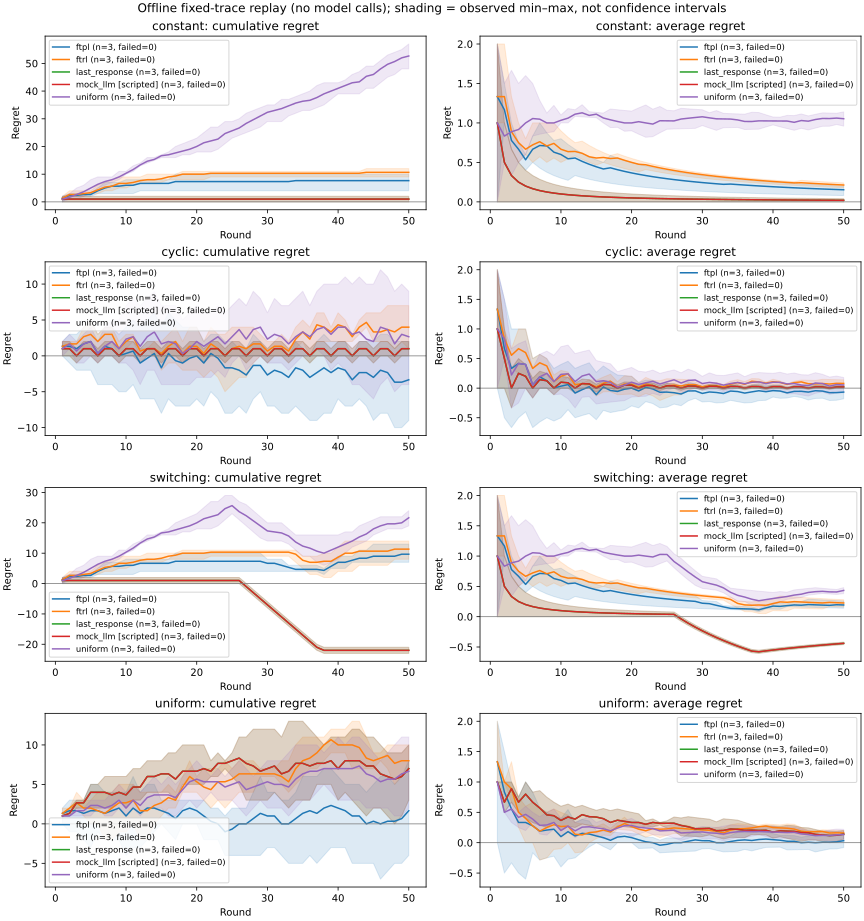
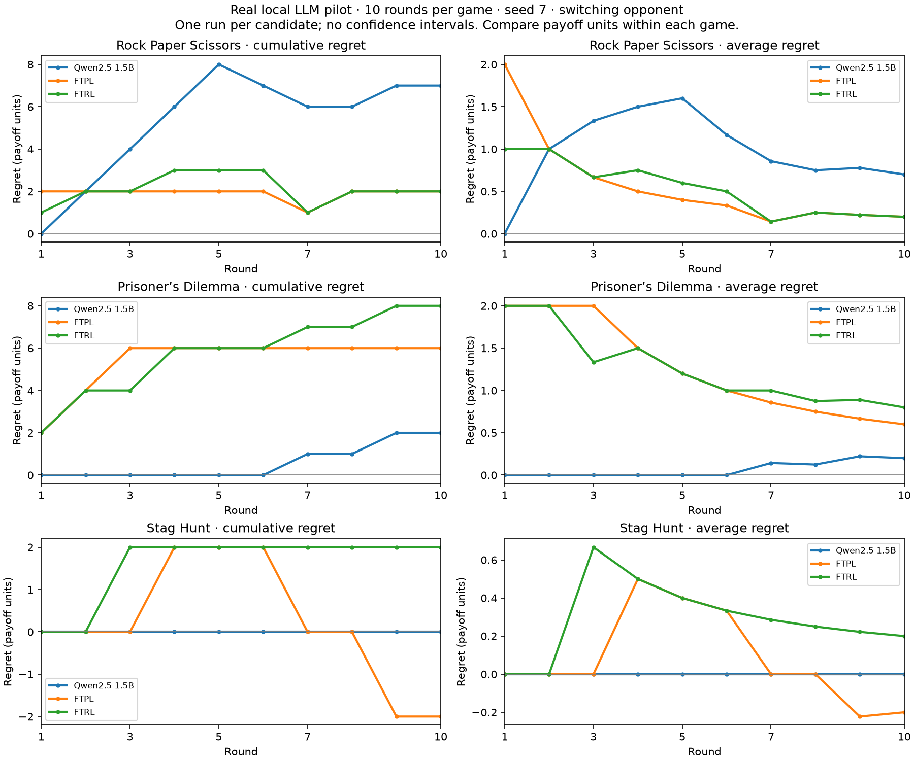

# Repeated LLM regret benchmarks

The [external-regret evaluator](external-regret.md) measures a completed trajectory.
The benchmark runner uses that evaluator to compare existing SDK LLM agents with
FTPL, FTRL/Hedge, and simple policies on identical fixed opponent sequences. It
supports RPS, Prisoner's Dilemma, and Stag Hunt. Games execute through local
`GameSession` instances, configured engines, registered metrics, and
`MatchEvaluator`; no running server or new result API is needed.

This is an evaluation implementation inspired by
[Do LLM Agents Have Regret? (ICLR 2025)](https://proceedings.iclr.cc/paper_files/paper/2025/file/65ea878cb90b440e8b4cd34fe0959914-Paper-Conference.pdf).
It does not reproduce the paper's full experimental protocol or implement
regret-loss training. The included free mock runs establish software behavior,
not empirical findings about LLM intelligence.

## Start without a model or API key

From the repository root:

```bash
uv run python scripts/regret_benchmark.py \
  --config docs/examples/regret_benchmark/free.yaml \
  --output-dir results/regret-free
```

This runs 60 trials: 3 seeds × 4 traces × 5 policies. The policies are:

| Candidate | Behavior |
|---|---|
| `ftpl` | The seeded full-information FTPL baseline from the evaluator examples |
| `ftrl` | The seeded entropy-regularized FTRL/Hedge baseline |
| `uniform` | Independently sample a legal action each round |
| `last_response` | Random first action; subsequently maximize payoff against the opponent's previous action |
| `mock_llm` | A **scripted mock**, using `last_response` decisions through the existing SDK's strict decision path; it makes no model requests |

In RPS, `last_response` has the same decision rule as the existing CounterAgent.
The rule also uses the actual configured payoffs for PD and Stag Hunt.
Mock and real model trials have distinct `candidate_kind` metadata.

Use a new output directory for each run. An existing `trials.jsonl` is never
silently overwritten. For optional standalone SVG/PNG comparison figures:

```bash
uv run --with matplotlib python scripts/regret_benchmark.py \
  --config docs/examples/regret_benchmark/free.yaml \
  --output-dir results/regret-free-plots
```

All automated tests run without model credentials. The injected completion
interface exercises the registered per-game SDK parsers and audit records.

## Included free comparison

The [sample final statistics](../examples/regret_benchmark/sample-finals.csv) and
figure below come from `free.yaml`: 50 rounds, seeds 7/19/31, 60 successful trials,
and zero model requests. These are mean **average external regret** at round 50:

| Opponent trace | FTPL | FTRL | Uniform | Last response / scripted mock |
|---|---:|---:|---:|---:|
| Constant | 0.1533 | 0.2133 | 1.0533 | 0.0200 |
| Cyclic | -0.0667 | 0.0800 | 0.0533 | 0.0200 |
| Switching | 0.1933 | 0.2267 | 0.4333 | -0.4400 |
| Uniform | 0.0333 | 0.1600 | 0.1333 | 0.1400 |



The scripted mock and last-response curves overlap because they use the same
policy and seed. They demonstrate that the SDK decision path preserves that
policy's actions; the mock is not a measured language model. FTPL has lower regret
than FTRL in these four small samples, while the last-response policy beats both
on the constant and switching traces. This illustrates why a single trace cannot
establish a general ranking.

On the switching trace, the last-response policy earns a mean payoff of 47,
versus 25 for the best fixed move, giving cumulative regret -22 and average
regret -22/50 = -0.44. Its adaptation beats every single repeated move. This is
different from competing against a per-round oracle, which could earn 50 here.
The figure's left panels show cumulative regret; the right panels divide each
prefix by its own round count. The shaded ranges describe only these three
repetitions and provide no proof of convergence or asymptotic guarantees.

## Local LLM pilot

A separate pilot ran Qwen2.5 1.5B locally through Ollama 0.17.0 against a switching
opponent sequence in all three supported games. Each game used 10 rounds and seed
7 for its trace and classical policies. All 30 model responses were valid, and all
15 model/baseline trials completed. Model sampling used temperature 0.7 without an
explicit inference seed.



The left column shows cumulative regret; the right shows average regret. Final
average external regret was:

| Game | Qwen2.5 1.5B | FTPL | FTRL |
|---|---:|---:|---:|
| Rock Paper Scissors | 0.70 | 0.20 | 0.20 |
| Prisoner's Dilemma | 0.20 | 0.60 | 0.80 |
| Stag Hunt | 0.00 | -0.20 | 0.20 |

Compare values within each game because payoff scales differ. This single-run,
short-horizon pilot validates the real SDK/model pathway and does not establish
convergence or a general model ranking. Payoffs and all 300 prefix values across
both player perspectives were independently checked against explicit matrices.

Committed sources include the [model metadata and action histories](../examples/regret_benchmark/local-qwen-pilot.yaml),
[final results](../examples/regret_benchmark/local-qwen-pilot-finals.csv), and
[complete curves](../examples/regret_benchmark/local-qwen-pilot-curves.csv).

## Configure actual LLM runs

Copy [model.yaml](../examples/regret_benchmark/model.yaml) and replace the model
identifier and compatible endpoint with your provider's settings. `api_key_env`
names an environment variable containing the credential; the configuration and
saved reports contain only that variable's name. Do not put an API key in YAML
or the endpoint URL. Provider calls remain disabled unless explicitly enabled.

Preview the workload without reading credentials or contacting a model:

```bash
uv run python scripts/regret_benchmark.py \
  --config docs/examples/regret_benchmark/model.yaml --dry-run
```

The supplied model template plans 12 complete trials per candidate and at most
240 model completion attempts: 20 rounds × 3 seeds × 4 traces × 1 model × 1 attempt.
With the credential exported in the named environment variable, opt in explicitly:

```bash
uv run --with matplotlib python scripts/regret_benchmark.py \
  --config docs/examples/regret_benchmark/model.yaml \
  --allow-model-calls --max-model-calls 240 \
  --output-dir results/regret-model-study
```

The budget must cover the worst-case number of configured attempts before any
model access is allowed. Each attempt consumes one budget unit before invocation,
including failed requests and invalid responses. SDK HTTP retries are disabled;
`max_attempts` controls the explicitly logged per-round retries. `timeout` bounds
each request. The request cap is not a currency or total-token budget; prompt
length grows with the complete visible history. `max_tokens` limits each model
response. The free baseline example makes no model requests; the separate pilot
above uses local inference without paid provider access.

Existing SDK agents perform each decision through `BaseAgent.decide_once`.
This is a plain-text decision protocol with tools and communication disabled,
so it is a specified research condition rather than a claim about the behavior
of the SDK's usual live tool-calling loop. The ordinary SDK parsers retain their
legacy behavior for existing users.

## Fairness, feedback, and game settings

Every candidate in a game/seed/trace block faces the **same exact** opponent
sequence. Candidate RNGs do not consume the opponent trace generator's RNG.
All candidates choose before the current opponent action is applied. The model
receives the game's existing system/turn prompts, the complete past round history,
and the actual finite stage-payoff table. It receives no current or future
opponent action or sequence name. FTPL and FTRL use the same full-information
payoffs reconstructed after each completed round.

The generated traces use the game's ordered canonical action set:

- `constant`: repeat its first action.
- `cyclic`: cycle through its actions.
- `switching`: first action for the first half, then last action.
- `uniform`: seeded uniform sampling.

Set `game` to `prisonersdilemma` or `stag_hunt` for those existing games. Supply
custom payoffs under `game_config`, for example:

```yaml
game: prisonersdilemma
rounds: 50
seeds: [7, 19, 31]
game_config:
  payoff_T: 9
  payoff_R: 6
  payoff_P: 2
  payoff_S: -2
```

The report records resolved game defaults and actual configured values in every
trial. Noise must be zero. `game_config` cannot override the top-level game,
round count, or seed, and unknown game settings are rejected. Baseline eta is
`sqrt(2 log(K)/T)` for the configured horizon and is recorded in each policy's
settings; each prefix uses that same run's learner, without restarting it.

For a recorded opponent sequence, add a named trace of exactly `rounds` canonical
actions. It can be evaluated alongside generated traces, or use `traces: []`:

```yaml
game: rock_paper_scissors
rounds: 3
seeds: [7, 19]
traces: []
recorded_traces:
  recording_1: [rock, scissors, paper]
```

The local seeds control generated traces and classical policies. They are not
passed to the provider as a promise of deterministic model output. Repeating a
model request can differ even with the same recorded settings. Raw responses and
executed actions are preserved so the resulting regret can be rechecked.

## Audit records and invalid decisions

The model must return exactly one canonical action, ignoring capitalization and
surrounding whitespace. Extra explanations, ambiguous alternatives, empty
responses, and unknown actions are invalid under this protocol. Each attempt
records its exact messages, raw response, the existing SDK parser's proposed
result, strict validity, executed action if valid, and available response ID,
reported provider model identifier, and token usage.

A forgiving SDK parser might propose rock for `nonsense`; the benchmark records
that proposal but **does not execute it**. Retries see the same game state, with
no new opponent feedback. If all attempts fail, the whole trial is marked failed,
its exact metric is unavailable, and the successfully completed prefix history
is retained for diagnosis. Provider errors retain the exception type and prompts;
the exception message is omitted because it can expose credentials. No failed
round is converted into a fabricated action or zero payoff.

Each completed or failed trial is checkpointed immediately to `trials.jsonl`.
The command exits with status 2 if any trial failed, after writing the report.
A process interruption can leave those checkpoints without a final report;
automatic resumption is not implemented.

## Outputs and interpretation

| File | Contents |
|---|---|
| `trials.jsonl` | One audited trial per line, including actions, prompts/responses, session ID, history, complete engine/evaluator results, and failure status |
| `report.json` | Public experiment configuration, protocol, shared traces, request usage, Arena version, aggregate curves, and paired comparisons |
| `curves.csv` | Tidy mean, sample standard deviation, observed minimum/maximum, and completion/failure counts for each metric and round |
| `comparison.svg` / `comparison.png` | Optional cumulative and average regret curves; lines are means and shading is the observed min/max |

The aggregation unit is a complete seeded trial, not individual rounds. All
prefixes use the same cohort of successful complete runs. Failure counts are
shown separately. All-failed candidates have null summary values and no curve;
failures are never averaged as zeros. Complete-case comparisons can be optimistic
when failure is related to difficult interactions, so always inspect failure
rates alongside regret.

Paired model-minus-FTPL and model-minus-FTRL normalized-average differences use
only seeds where both candidates completed the identical opponent trace. Negative
differences favor the model. The report lists included and excluded pair counts.
Sample standard deviations and observed min/max bands are **descriptive spread,
not confidence intervals or statistical significance tests**. One repetition has
zero observed spread but provides no estimate of broader variability.

Offline replay does not model an adaptive opponent's counterfactual response.
Live agent-vs-agent research requires separate sessions. Finite empirical average
regret curves do not prove an asymptotic no-regret guarantee or that an LLM
internally implements FTPL or FTRL. This PR adds evaluation and reproducibility;
training, causal live-opponent claims, and asymptotic hypothesis testing remain
outside its scope.

## Inspect a completed match in the UI

On a backend including this PR, complete an RPS, PD, or Stag Hunt match and open
its History tab. The External regret panel shows each player's actual payoff,
best fixed move/payoff, signed cumulative and average regret, and normalization.
Switch between cumulative and average curves and inspect prefixes with the round
slider. Unavailable cases show their reasons. Download JSON preserves the full
result and prefix series. The existing leaderboard estimate is explicitly labeled
**Legacy regret**.

The benchmark command writes local research artifacts; its in-memory sessions are
not persisted to the web session list. Launching paid benchmark batches from the
browser is not part of this PR.
